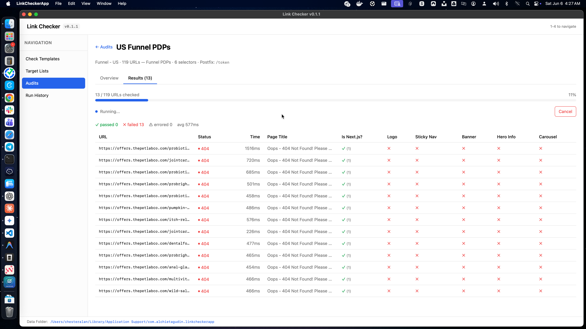

# Link Checker

A desktop app for checking web pages. It does three jobs:

- **Selector audits.** Check pages against assertions: CSS selectors, HTTP status, regex, attributes, JavaScript and accessibility checks.
- **Link scans.** Crawl a page and report broken links.
- **Accessibility audits.** Check pages against WCAG / EN 301 549 with a built-in static rule engine or with axe-core in headless Chromium.



Built with [Tauri v2](https://tauri.app), [React 19](https://react.dev), [TypeScript 6](https://www.typescriptlang.org) and [Tailwind CSS v4](https://tailwindcss.com).

## Features

### Selector audits
- **Target Lists**: named URL collections. Import them from `.txt`/`.csv` or scrape links from a live page.
- **Check Templates**: named sets of checks. Check types are `selector`, `status`, `regex`, `attribute`, `accessibility` and `javascript`.
- **Audits**: bind a Target List to a Check Template, then pick a mode (sequential or batch), a batch size and a timeout.
- **Quick Audit**: run a Check Template against ad-hoc URLs without saving a Target List.
- **Origin Override / URL Postfix**: rewrite the domain or append a suffix (for example `?preview=true`) for a run.
- **Live results**: progress and per-URL results stream in while the run is in progress. Runs can be cancelled; the partial run is kept.
- **Run History**: browse past runs, set a baseline, compare two runs side by side, and see pass/fail trends. History older than the retention period (90 days by default, adjustable under **Prune Old**) is pruned at startup and after each run.
- **Export**: download results as CSV or JSON. CSV cells that start with `=`, `+`, `-` or `@` are prefixed with `'` so spreadsheets do not run them as formulas.

### Link checker
- Crawl from a start URL to a set depth and report broken links. An accessibility pass can be included. Scans can be cancelled and keep their partial results.
- Saved scan history.

### Accessibility
- Two engines: a **static Rust rule engine** (no browser needed) and **axe-core** (needs a Chromium-based browser).
- Choose the standards to audit against: WCAG 2.0 / 2.1 / 2.2, Section 508, EN 301 549 and best practices.
- Scored reports. You can re-run pages that errored (using the report's own engine and rules) and compare two reports. Pages that errored on either side of a comparison are listed separately, never as resolved.
- Export reports as HTML or JSON.

### General
- Global search (`⌘K`), light/dark theme, keyboard shortcuts (`1`–`6` to switch pages, `?` to list them all).
- Data safety: `data.json` is written atomically with a `data.json.bak` copy. A corrupt file is moved aside and reported in a banner instead of being overwritten.

## Getting started

Prerequisites: [Bun](https://bun.sh) 1.3+, a Rust toolchain, and the [Tauri system dependencies](https://tauri.app/start/prerequisites/) for your OS. The axe-core engine also needs Chrome, Chromium, Edge or Brave.

Prebuilt installers are published on the project's GitHub Releases page; they are no longer committed to the repository.

Optional environment variables (see `.env.example`):

| Variable | Purpose |
|---|---|
| `A11Y_CHROME_PATH` | Absolute path to a Chromium-based browser for the axe-core engine. Overrides auto-detection; required on Windows. |
| `A11Y_TEST_URL` | Page used by the ignored axe smoke test (`cargo test --manifest-path src-tauri/Cargo.toml -- --ignored`). Defaults to `https://example.com`. |

```bash
bun install
bun tauri dev       # run the app with hot reload
bun tauri build     # production bundle
```

## Scripts

| Command | Description |
|---|---|
| `bun run dev` | Vite dev server (frontend only) |
| `bun run build` | TypeScript build + Vite build |
| `bun run lint` | ESLint |
| `bun run typecheck` | `tsc -b --noEmit` |
| `bun run format` / `format:check` | Prettier |
| `bun run test` / `test:run` / `test:coverage` | Vitest (watch / single run / coverage) |
| `bun tauri dev` | Run the desktop app in dev mode |
| `bun run build:tauri` | Frontend build + Tauri bundle |
| `cargo test --manifest-path src-tauri/Cargo.toml` | Rust tests |

## How it works

The React frontend calls typed `invoke` wrappers in `src/lib/tauri.ts`. On the Rust side:

- `reqwest` fetches pages, and `scraper` parses them and evaluates the checks.
- The JavaScript check type runs on `boa_engine`.
- The axe-core engine uses `chromiumoxide` to drive headless Chromium.

Progress streams back to the frontend as Tauri events. All data is stored as JSON files in the app data directory, for example `~/Library/Application Support/com.alchietagudin.linkcheckerapp/` on macOS.

## Project structure

```
src/
├── components/     # Shared UI (Modal, ResultsTable, Sidebar, TrendsChart, VirtualList, …)
├── hooks/          # StoreProvider/StoreContext, RunContext/useRun, ThemeContext, useHotkeys
├── lib/            # tauri.ts (typed invoke wrappers), a11yReportHtml.ts (HTML report export)
├── pages/          # Target lists, check templates, audits, history/diff, link checker, accessibility
├── types/          # TypeScript interfaces mirroring Rust models
├── utils/          # CSV, URL resolution, a11y scoring/standards, constants
└── __tests__/      # Vitest tests
src-tauri/
├── assets/axe.min.js   # Bundled axe-core
└── src/
    ├── commands/       # Tauri command handlers (CRUD, runs, a11y, files)
    ├── checker.rs      # Fetch + parse + check engine, link scanning
    ├── a11y.rs         # Static accessibility rule engine
    ├── a11y_browser.rs # Headless Chromium + axe-core
    ├── a11y_runner.rs  # Accessibility audit runner
    ├── models.rs       # Shared structs (serde camelCase)
    ├── storage.rs      # JSON file persistence
    └── lib.rs          # AppState + command registration
```

## Documentation

| Doc | Contents |
|---|---|
| [docs/ARCHITECTURE.md](docs/ARCHITECTURE.md) | System overview, Tauri commands and events, state, routing, data model and storage |
| [docs/LINK_CHECKING.md](docs/LINK_CHECKING.md) | Selector audits, check types, run execution, history/diff/trends, link scans |
| [docs/ACCESSIBILITY.md](docs/ACCESSIBILITY.md) | Accessibility engines, rules, standards, scoring and reports |
| [docs/DEVELOPMENT.md](docs/DEVELOPMENT.md) | Setup, testing, CI, release and version bumps, troubleshooting |
| [docs/AUDIT.md](docs/AUDIT.md) | Code audit findings and recommended fixes |
| [docs/plan.md](docs/plan.md), [docs/a11y-plan.md](docs/a11y-plan.md) | Original design plans (historical) |
| [docs/FEATURES.md](docs/FEATURES.md), [docs/checklist.md](docs/checklist.md) | Feature ideas and build checklist |
