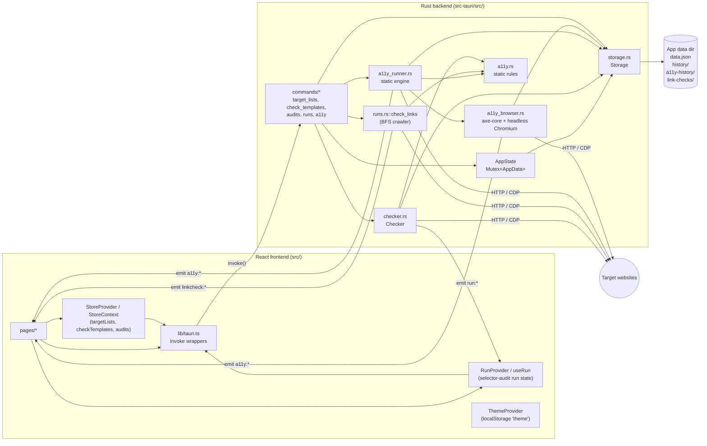
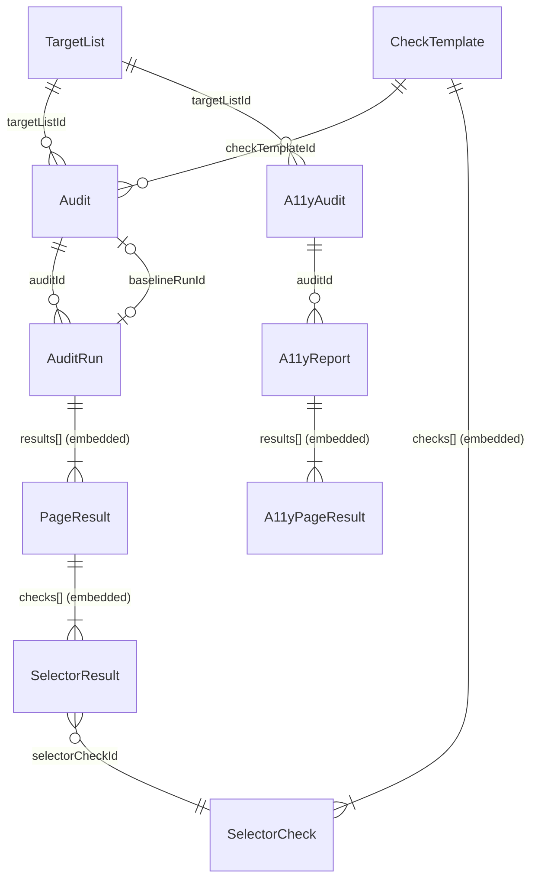

# Architecture

This document describes how LinkCheckerApp is put together. Every statement points to the source file it comes from. If the code and this document disagree, the code is correct.

## 1. System overview

LinkCheckerApp is a **Tauri v2** desktop app with three layers:

| Layer | Location | Responsibility |
|---|---|---|
| Tauri shell | `src-tauri/src/main.rs`, `src-tauri/src/lib.rs`, `src-tauri/tauri.conf.json`, `src-tauri/capabilities/default.json` | Opens the window, registers plugins (`log` in debug builds only, `dialog`, `opener`), creates the app data dir, builds `AppState`, and registers every IPC command. |
| Rust backend | `src-tauri/src/` | CRUD over persisted entities, HTTP fetching (`reqwest`), HTML parsing (`scraper`), the selector/regex/attribute/status/JS check engine (`checker.rs`, with `boa_engine` for JavaScript checks), the link crawler (`commands/runs.rs::check_links`), static accessibility rules (`a11y.rs`), and axe-core in headless Chromium (`a11y_browser.rs`, via `chromiumoxide`). |
| React frontend | `src/` | React 19 + TypeScript + Tailwind. Typed `invoke` wrappers live in `src/lib/tauri.ts`. Global state lives in context providers under `src/hooks/`. Pages live in `src/pages/`. |

The shell holds shared state in `AppState` (`src-tauri/src/lib.rs`):

```rust
pub struct AppState {
    pub data: Mutex<AppData>,   // in-memory copy of data.json
    pub storage: Storage,       // file persistence (storage.rs)
    pub checker: Checker,       // selector-audit runner + cancel flag (checker.rs)
    pub a11y_runner: A11yRunner,// a11y runner + cancel flag (a11y_runner.rs)
}
```

At startup, `lib.rs::run` does the following in order:

1. Resolves `app.path().app_data_dir()` and creates it.
2. Calls `Storage::migrate_old_history()`, which turns a legacy `history.json` into per-run files.
3. Calls `Storage::load()` to read `data.json` into `AppData`. A corrupt file is moved aside to `data.json.corrupt-<ts>` (or restored from `data.json.bak`) and reported through `get_storage_warnings`; a file from a newer schema version disables saving.
4. Prunes history older than `max_history_days`, sets the window title to `Link Checker v<version>`, and manages `AppState`.

### Backend modules

| File | Purpose |
|---|---|
| `src-tauri/src/models.rs` | All serde structs that cross IPC or are persisted. Most use `#[serde(rename_all = "camelCase")]`. |
| `src-tauri/src/storage.rs` | Reads and writes JSON in the app data dir (see §7). |
| `src-tauri/src/checker.rs` | `Checker::run`: fetches each URL and runs `CheckType::{Selector, Status, Regex, Attribute, Accessibility, JavaScript}` checks. It applies `origin_override`/`url_postfix`, emits `run:*` events tagged with the run's `runId`, checkpoints the partial run, and saves the final run. Also holds the `CancelRegistry` (one `CancelToken` per run or link scan). |
| `src-tauri/src/a11y.rs` | `run_a11y_scan(html, &A11yCheckConfig)`: static rule categories (document, headings, landmarks, aria, interactive, media, tables, forms). |
| `src-tauri/src/a11y_runner.rs` | `A11yRunner` allows one accessibility job (run or re-run) at a time: `begin(job_id)` returns a `JobGuard` with a `CancelToken`. `run_static_audit`/`scan_urls_static` run the static engine concurrently (batch size clamped to 1..=50, timeout >= 1 s). Also contains `compute_a11y_summary` and `sanitize_audit_config`. |
| `src-tauri/src/a11y_browser.rs` | Finds a Chromium-family browser (env `A11Y_CHROME_PATH`, then fixed macOS/Linux paths, then `which`). Injects the bundled `src-tauri/assets/axe.min.js` (`include_str!`), runs `axe.run` with tags mapped from the selected standards, and converts violations to `A11yIssue`. Captures the real HTTP status; 4xx/5xx pages become errored results. Contains `run_axe_audit` and `scan_urls_axe`. |
| `src-tauri/src/commands/*.rs` | `#[tauri::command]` handlers, grouped by domain (§3). `commands/mod.rs` adds `AppState::lock_data()` (poison-tolerant) and `AppState::mutate_data(f)`, which applies a change to a copy, saves it, and only then commits it in memory. |

## 2. Component and data-flow diagram



**Typical selector-audit flow:**

1. `AuditDetailPage` calls `useRun().start(auditId)` (`src/hooks/RunContext.tsx`).
2. `start` generates a `runId` (UUID), subscribes to `run:*` events (ignoring events for other runs), then calls `runAudit(auditId, …, runId)`, which invokes the `run_audit` command.
3. `commands/runs.rs::run_audit` registers a cancel token for the run, clones the `Audit`, `TargetList` and `CheckTemplate` out of `AppState.data`, then calls `Checker::run`.
4. For each page, `Checker::run` emits `run:progress` and `run:result`. A single collector task checkpoints the partial `AuditRun` (status `"running"`, compact JSON) to `history/` at most every 25 pages or 3 s.
5. At the end it saves the final run, then emits `run:cancelled` (if cancelled) and `run:complete`. The command resolves with the `runId`; on failure it emits `run:error` and rejects. History retention is applied after the run.

## 3. Tauri commands

All commands are registered in `src-tauri/src/lib.rs` (`tauri::generate_handler!`). Wrappers live in `src/lib/tauri.ts`. Arguments are camelCase on the JS side: either through `#[tauri::command(rename_all = "camelCase")]` or because Tauri converts the default snake_case arguments.

### Target Lists: `src-tauri/src/commands/target_lists.rs`

| Command | Purpose | Frontend wrapper |
|---|---|---|
| `list_target_lists` | Returns `AppData.target_lists`. | `listTargetLists` |
| `create_target_list` | Creates a list with a new UUID. URLs are normalized (adds `https://` when no scheme is given). Saves `data.json`. | `createTargetList` |
| `update_target_list` | Patches name, urls (normalized like create), pinned and folder. Saves. | `updateTargetList` |
| `delete_target_list` | Removes the list. Saves. Rejects with "This target list is used by N audit(s): …" while any selector or accessibility audit references it. | `deleteTargetList` |

### Check Templates: `src-tauri/src/commands/check_templates.rs`

| Command | Purpose | Frontend wrapper |
|---|---|---|
| `list_check_templates` | Returns `AppData.check_templates`. | `listCheckTemplates` |
| `create_check_template` | Creates a template of `SelectorCheck`s. A unique, non-empty check `id` sent by the frontend is kept; otherwise a UUID is generated. Saves and returns the template. | `createCheckTemplate` |
| `update_check_template` | Patches name, checks (keeping their ids, as for create), pinned and folder. Saves and returns the template, which the store adopts. | `updateCheckTemplate` |
| `delete_check_template` | Removes the template. Saves. Rejects while any audit references it. | `deleteCheckTemplate` |

### Audits (selector audits): `src-tauri/src/commands/audits.rs`

| Command | Purpose | Frontend wrapper |
|---|---|---|
| `list_audits` | Returns `AppData.audits`. | `listAudits` |
| `create_audit` | Binds a TargetList and a CheckTemplate with an `AuditConfig` (`batchSize` and `timeoutSecs` clamped to >= 1). Saves. | `createAudit` |
| `update_audit` | Patches name, config, originOverride, urlPostfix, pinned, folder and baselineRunId. It cannot change `targetListId` or `checkTemplateId`. Saves. | `updateAudit` |
| `delete_audit` | Removes the audit, saves, and then deletes its run files (`Storage::delete_audit_runs`). | `deleteAudit` |

### Runs, history, link checking and utilities: `src-tauri/src/commands/runs.rs`

| Command | Purpose | Frontend wrapper |
|---|---|---|
| `run_audit` | Runs a saved audit. Optional per-run `originOverride`/`urlPostfix` and a frontend-generated `runId`. Streams `run:*` events, saves the run, and resolves with the `runId`. On failure emits `run:error` and rejects. | `runAudit` (via `RunContext.start`) |
| `quick_run` | Runs ad-hoc URLs and checks using a synthetic `Audit`, `TargetList` and `CheckTemplate`. Same `runId`/error contract as `run_audit`. | `runQuickAudit` (via `RunContext.startQuick`) |
| `cancel_run` | Cancels the run with `runId`, or every active run when omitted. | `cancelRun` |
| `cancel_link_check` | Cancels the link scan with `scanId`, or every active scan when omitted. | `cancelLinkCheck` |
| `list_run_files` | Lightweight run index built from `history/run-*.json` file names (full run id, UTC timestamp from the name). | `listRunFiles` |
| `list_all_runs` | 100 most recent runs, parsed without `results`. | `listAllRuns` (no caller in `src/`) |
| `list_audit_runs` | All runs of one audit (filtered before any limit), parsed without `results`. | `listAuditRuns` |
| `get_run_results` | Loads one full `AuditRun` by id. | `getRunResults` |
| `clear_history` | Deletes every file in `history/`. | `clearHistory` |
| `prune_history` | Deletes runs, accessibility reports and link scans older than `AppData.max_history_days`, using the timestamp in the file name. Also runs at startup and after each run. | `pruneHistory` |
| `get_history_retention` | Returns `max_history_days`. | `getHistoryRetention` |
| `set_history_retention` | Sets `max_history_days` (1..=36500; 0 is rejected), saves `data.json`, and prunes immediately. | `setHistoryRetention` (Run History → Prune Old) |
| `scrape_links` | Fetches one page and returns its links. | `scrapeLinks` |
| `scrape_selectors` | Fetches pages concurrently and suggests id, class and `data-testid` selectors, or a custom selector. | `scrapeSelectors` |
| `check_links` | BFS link crawl, described below. Optional `scanId`. Streams `linkcheck:*` events, saves a `LinkCheckScan` (partial if cancelled), and returns `LinkCheckResult[]`. | `checkLinks` |
| `list_link_check_scans` | Summaries (`LinkCheckScanInfo`) of saved scans, newest first by file-name timestamp. | `listLinkCheckScans` |
| `get_link_check_scan` | Loads one scan. | `getLinkCheckScan` |
| `delete_link_check_scan` | Deletes one scan file. | `deleteLinkCheckScan` |
| `get_data_path` | Returns the app data dir path. | `getDataPath` |

### Files: `src-tauri/src/commands/files.rs`

The webview never chooses filesystem paths. The native dialogs run on the Rust side (A-08).

| Command | Purpose | Frontend wrapper |
|---|---|---|
| `save_text_file` | Shows a native Save dialog and writes `content` atomically. Resolves to the chosen path, or `null` if cancelled. | `saveTextFile` |
| `open_text_file` | Shows a native Open dialog and returns the file's text (max 20 MB), or `null` if cancelled. | `openTextFile` |
| `reveal_data_folder` | Opens the app data dir in Finder, Explorer or the Linux file manager (`tauri-plugin-opener`). | `openDataFolder` |
| `get_storage_warnings` | Startup storage problems (corrupt `data.json` moved aside, restored from backup, saving disabled). Empty when fine. | `getStorageWarnings` (banner in `App.tsx`) |

How `check_links` crawls:

- `max_depth` is capped at 5, and the crawl stops after 500 URLs (`MAX_LINK_CHECKS`).
- At most 10 requests run at once (a `Semaphore`).
- By default it only follows links on the same origin.
- It sends GET when it needs the page body (to expand links or to run the static a11y scan) and HEAD otherwise.
- Only http(s) seed URLs are accepted. Bodies are read up to 2 MB (bytes) and decoded as lossy UTF-8.
- Cancelling stops the crawl promptly; the partial scan is saved and `linkcheck:cancelled` is emitted.

### Accessibility: `src-tauri/src/commands/a11y.rs`

| Command | Purpose | Frontend wrapper |
|---|---|---|
| `list_a11y_audits` | Returns `AppData.a11y_audits`. | `listA11yAudits` |
| `create_a11y_audit` | Takes one `input` object (`A11yAuditInput`). `engine` defaults to `"static"`; batch size and timeout are sanitized. Saves. | `createA11yAudit` (wraps the data as `{ input }`) |
| `update_a11y_audit` | Patches fields, including `targetListId` and `engine`. Saves. | `updateA11yAudit` |
| `delete_a11y_audit` | Removes the audit, saves, and deletes its reports (`delete_a11y_audit_reports`). | `deleteA11yAudit` |
| `run_a11y_audit` | Runs the static or axe-core engine and saves the final `A11yReport`, then emits the terminal event. Rejects with "An accessibility run is already in progress" if a run or re-run is active. | `runA11yAudit` |
| `cancel_a11y_run` | Cancels the active accessibility run or re-run. | `cancelA11yRun` |
| `list_a11y_reports` | `A11yReportInfo[]`, newest first by the timestamp in the file name. | `listA11yReports` |
| `get_a11y_report` | Loads one report. | `getA11yReport` |
| `delete_a11y_report` | Deletes one report file. | `deleteA11yReport` |
| `rerun_a11y_pages` | Re-scans the given `urls`, or every page that has `error` set when no URLs are given. Scans with the report's stored engine, standards, minimum severity and categories (inferred for legacy reports). Merges the new results by URL, recomputes the summary, re-saves the report under the same file, and returns it. Rejects while another accessibility job is active. | `rerunA11yPages` |

## 4. Event channels (backend to frontend)

All events are sent with `app.emit(...)`, which broadcasts to every window.

| Event | Emitted in | Payload | Listened in |
|---|---|---|---|
| `run:progress` | `checker.rs` | `{ runId, checked, total }` | `src/hooks/RunContext.tsx` |
| `run:result` | `checker.rs` | `PageResult & { runId }` | `RunContext.tsx` |
| `run:complete` | `checker.rs` (after the final save) | `AuditRun & { runId }` | `RunContext.tsx` |
| `run:cancelled` | `checker.rs` (just before `run:complete`) | `{ runId }` | `RunContext.tsx` |
| `run:error` | `commands/runs.rs` | `{ runId, message }` | `RunContext.tsx` |
| `linkcheck:result` | `commands/runs.rs::check_links` | `LinkCheckResult & { scanId }` | `src/pages/LinkCheckerPage.tsx` |
| `linkcheck:discovered` | `check_links` | `{ scanId, url, depth, sourceUrl }` | `LinkCheckerPage.tsx` |
| `linkcheck:checking` | `check_links` | `{ scanId, url, depth, sourceUrl }` | `LinkCheckerPage.tsx` |
| `linkcheck:cancelled` | `check_links` | `{ scanId }` | `LinkCheckerPage.tsx` |
| `a11y:progress` | `a11y_runner.rs`, `a11y_browser.rs` | `{ reportId, checked, total, rerun }` | `AccessibilityPage.tsx`, `A11yReportPage.tsx` (re-runs) |
| `a11y:result` | `a11y_runner.rs`, `a11y_browser.rs` | `A11yPageResult & { reportId, rerun }` | `AccessibilityPage.tsx`, `A11yReportPage.tsx` (re-runs) |
| `a11y:complete` | `commands/a11y.rs` (after the save) | `A11yReport` | not listened to; the `runA11yAudit` promise is the terminal signal |
| `a11y:cancelled` | `commands/a11y.rs` (followed by `a11y:complete`) | `A11yReport` | not listened to |
| `a11y:error` | `commands/a11y.rs` (lookup failure, job already running, browser launch failure, save failure) | `{ reportId: string \| null, message }` | not listened to; the command rejects with the same message |

Every payload carries the id of its operation, so pages ignore events from other runs. Re-runs (`rerun_a11y_pages`) emit only `a11y:progress`/`a11y:result` with `rerun: true`; the command's return value is the terminal signal.

## 5. Frontend state management

The provider order comes from `src/main.tsx`:

```
StrictMode > BrowserRouter > ThemeProvider > RunProvider > StoreProvider > App
```

- **StoreProvider / StoreContext** (`src/hooks/StoreProvider.tsx`, `src/hooks/StoreContext.tsx`; `useStore` is re-exported from `src/hooks/useStore.ts`)
  - Holds `targetLists`, `checkTemplates`, `audits` and `loading`, loaded once on mount through `Promise.all` of the three `list_*` commands.
  - CRUD actions call the API first and then update local state with the returned entity. They are not optimistic, with one exception: `patchCheckTemplate` updates local state immediately and debounces `updateCheckTemplate` (300 ms). On success it adopts the returned template; on failure it rolls back and sets `saveError`.
  - Also exposes `loadError` (with `reload()`), `saveError` and `storageWarnings`, which `App.tsx` shows as banners.
  - `reload()` fetches everything again.
  - A11y audits, reports, runs and link scans are **not** in the store. Pages load them directly. For example, `AccessibilityPage` calls `listA11yAudits` and `listA11yReports`.
- **RunProvider / RunContext** (`src/hooks/RunContext.tsx`) and **useRun** (`src/hooks/useRun.ts`)
  - State: `{ running, run, progress, runPagePath, ownerKey, runId, error }`. `ownerKey` is the page that started the run (`/audits/<id>` or a quick-audit path) and survives the run finishing, so pages only show their own results.
  - `start(auditId, ...)` and `startQuick(urls, checks, config, ...)` generate a `runId`, cancel any active run, subscribe to `run:*` events filtered by `runId`, then call the command. They never reject: failures set `error`.
  - `run:result` appends to `run.results`. `run:complete` replaces `run` and unsubscribes. If the command resolves first, the saved run is loaded with `getRunResults`.
  - Because this lives in a top-level provider, a run keeps going while the user navigates. `App.tsx` shows a global progress indicator and Cancel button in the header, and links to `runPagePath`.
  - This context covers selector audits only. Accessibility runs keep their state locally in `AccessibilityPage`, and link checks keep theirs in `LinkCheckerPage`.
- **ThemeProvider / useTheme** (`src/hooks/ThemeContext.tsx`)
  - `theme` is one of `'light' | 'dark' | 'system'` and is saved in `localStorage['theme']`.
  - `system` follows `prefers-color-scheme` through `useSyncExternalStore`.
  - Toggles the `dark` class on `<html>`.
  - `App.tsx` cycles the theme light → dark → system.
- **useHotkeys** (`src/hooks/useHotkeys.ts`): digit keys `1`–`6` navigate using `HOTKEY_NAV` (`src/utils/constants.ts`), and `?` toggles the shortcut modal (`App.tsx`). Bare keys are ignored while typing or when Cmd/Ctrl/Alt is held. `Mod+<key>` bindings match Cmd or Ctrl. Nothing fires while a modal dialog is open. `Sidebar.tsx` binds Cmd/Ctrl+K to search.

## 6. Routing

Routes are defined in `src/App.tsx` with `react-router-dom` (`BrowserRouter` is set up in `src/main.tsx`). All routes render inside an `ErrorBoundary` keyed by the path (so a crash on one page does not stick to every route), with `Sidebar` on the left. Unknown paths show a "Page not found" page.

| Path | Page component |
|---|---|
| `/` | Redirects to `/check-templates` |
| `/target-lists` | `TargetListsPage` |
| `/check-templates` | `CheckTemplatesPage` |
| `/check-templates/:id` | `CheckTemplateDetailPage` |
| `/check-templates/:id/quick-audit` | `QuickAuditPage` |
| `/audits` | `AuditsPage` |
| `/audits/:id` | `AuditDetailPage` |
| `/history` | `RunHistoryPage` |
| `/history/:runId` | `RunDetailPage` |
| `/history/diff/:runIdA/:runIdB` | `RunDiffPage` |
| `/link-checker` | `LinkCheckerPage` |
| `/link-checker/history` | `LinkCheckHistoryPage` |
| `/link-checker/history/:scanId` | `LinkCheckScanPage` |
| `/accessibility` | `AccessibilityPage` |
| `/accessibility/reports/diff/:idA/:idB` | `A11yReportDiffPage` |
| `/accessibility/reports/:reportId` | `A11yReportPage` |
| `*` | `NotFound` (in `App.tsx`) |

## 7. Data model and persistence

### Entities (`src-tauri/src/models.rs`)

**Configuration entities.** These are stored together in `data.json` as `AppData`.

| Entity | Key fields | Notes |
|---|---|---|
| `AppData` | `version` (schema version, currently 1), `target_lists`, `check_templates`, `audits`, `a11y_audits`, `max_history_days` (default 90) | This is the root document. It is **not** camelCase-renamed, so its keys are snake_case on disk. Every collection has `#[serde(default)]`. |
| `TargetList` | `id`, `name`, `urls[]`, `createdAt`, `updatedAt`, `pinned`, `folder?` | |
| `CheckTemplate` | `id`, `name`, `checks: SelectorCheck[]`, timestamps, `pinned`, `folder?` | |
| `SelectorCheck` | `id`, `selector`, `label`, `checkType`, `expectedStatus?`, `pattern?`, `attributeName?`, `attributeValue?`, `a11yConfig?` | `checkType` is `CheckType`: `selector` (default), `status`, `regex`, `attribute`, `accessibility`, or `javascript` (older files with `"javaScript"` still load). |
| `Audit` | `id`, `name`, `targetListId`, `checkTemplateId`, `config: AuditConfig`, `originOverride?`, `urlPostfix?`, `createdAt`, `pinned`, `folder?`, `baselineRunId?` | |
| `A11yAudit` | `id`, `name`, `targetListId`, `engine` (`"static"` or `"axe-core"`), `a11yConfig`, `config`, `originOverride?`, `urlPostfix?`, `createdAt`, `pinned`, `folder?` | |
| `AuditConfig` | `mode` (`"sequential"` or `"batch"`), `batchSize` (default 5), `timeoutSecs` (default 10), `headers`, `cookies: KeyValuePair[]` | |
| `A11yCheckConfig` | `minSeverity` (default `"minor"`), `categories[]`, `standards[]` | An empty list means "all". |

**Result entities.** Each record is saved as its own JSON file.

| Entity | Key fields |
|---|---|
| `AuditRun` | `id`, `auditId`, `startedAt`, `completedAt?`, `status` (`running`, `completed` or `cancelled`), `results: PageResult[]`, `summary: RunSummary` |
| `PageResult` | `url`, `pageTitle?`, `status?`, `statusText`, `responseTimeMs?`, `error?`, `checks: SelectorResult[]` (results are tagged with `runId` only in events) |
| `SelectorResult` | `selectorCheckId`, `selector`, `label`, `found`, `count`, `textContent?`, `checkType`, `a11yIssues[]` |
| `A11yReport` | `id`, `auditId`, `startedAt`, `completedAt?`, `status` (`running`, `completed`, `cancelled` or `error`), `results: A11yPageResult[]`, `summary: A11ySummary`, `standards[]`, `engine?`, `minSeverity?`, `categories?` (the last three are null on legacy reports) |
| `A11yPageResult` / `A11yIssue` | Per-page issues, plus `truncated` when the engine capped the issue list. Each issue has `issueType`, `element`, `selector`, `message`, `severity`, `wcag`, `standards[]` and `helpUrl?`. |
| `LinkCheckScan` | `id`, `url`, `maxDepth`, `sameOriginOnly`, `includeAccessibility`, `startedAt`, `completedAt?`, `results: LinkCheckResult[]` |
| `LinkCheckResult` | `url`, `sourceUrl`, `status?`, `statusText`, `error?`, `depth`, `a11yIssues[]` |

**Index and DTO types.** These are built on the fly and never stored: `RunFileInfo`, `A11yReportInfo`, `LinkCheckScanInfo`, and `ScrapedSelector`.

### Relationships



- References are plain string ids.
  - Deleting an `Audit` deletes its run files (`commands/audits.rs`).
  - Deleting an `A11yAudit` deletes its report files (`commands/a11y.rs`).
  - Deleting a `TargetList` or `CheckTemplate` is rejected while an audit (or, for lists, an accessibility audit) references it.
- `run_audit` reads the referenced list and template **at run time**. Runs store results only, not a snapshot of the configuration that produced them.
- Quick-audit runs (`quick_run`) get a random `auditId` that matches no saved `Audit`, plus empty list and template ids.
- `LinkCheckScan` does not reference any other entity.

### On-disk layout (`src-tauri/src/storage.rs`)

The root is Tauri's `app_data_dir()`, derived from the identifier `com.alchietagudin.linkcheckerapp` in `src-tauri/tauri.conf.json`.

```
<app_data_dir>/
├── data.json                                  # AppData (all configuration entities)
├── history/
│   └── run-<YYYY-MM-DD_HH-MM-SS>-<runId>.json        # one AuditRun per file
├── a11y-history/
│   └── a11y-<YYYY-MM-DD_HH-MM-SS>-<reportId>.json    # one A11yReport per file
└── link-checks/
    └── linkcheck-<YYYY-MM-DD_HH-MM-SS>-<scanId>.json # one LinkCheckScan per file
```

The legacy file `history.json` (a `Vec<AuditRun>`) is split into `history/` files and deleted at startup by `migrate_old_history`.

### Write strategy

- **Atomic writes:** every file is written with `storage::write_atomic` (temp file in the same directory, fsync, rename). Stale temp files are cleaned up during pruning.
- **`data.json`:** mutating commands go through `AppState::mutate_data`, which applies the change to a copy, saves it, and only then replaces the in-memory data. If the save fails, memory is unchanged and the command rejects. Each save also keeps the previous file as `data.json.bak`.
- **Loading `data.json`:** happens once at startup. If the file cannot be parsed it is moved to `data.json.corrupt-<unix ts>` and the backup is tried; the problem is reported through `get_storage_warnings` and shown as a banner. A file with a newer `version` disables saving so it is never overwritten by an older build.
- **Result files:** the file name comes from `startedAt` plus the id, so re-saving the same record overwrites the same file.
  - `Checker::run` checkpoints the partial run (compact JSON, status `"running"`) at most every 25 pages or 3 s, then saves the final run (pretty JSON) itself.
  - The accessibility runners save the final report from `commands/a11y.rs` before any terminal event is emitted.
- **Lookup by id:** `*_filepath_by_id` scans the directory for a name ending in `-<id>.json`.
- **Listings:**
  - `list_run_files`, `list_a11y_reports` and `list_link_check_scans` sort by the timestamp in the file name, newest first.
  - Listings parse header structs that skip per-page results.
  - `load_audit_runs(audit_id, limit)` filters by audit before applying the limit.
- **Retention:** `prune_history(max_days)` covers `history/`, `a11y-history/` and `link-checks/`, using the file-name date (falling back to `startedAt`, then mtime). It runs at startup, after each run or scan, and when the retention is changed. `max_history_days = 0` in an old file means keep forever; the UI only accepts 1–36500.
- **Frontend persistence:** only `localStorage['theme']` (`src/hooks/ThemeContext.tsx`).

## 8. Concurrency and cancellation

- **Selector audits** (`checker.rs`): concurrency comes from a `tokio::sync::Semaphore`, with 1 permit when `mode == "sequential"` and `batch_size` (clamped to 1..=50) permits otherwise. Timeouts are at least 1 s.
- **Static a11y engine** (`a11y_runner.rs`): uses the same semaphore model and clamps.
- **axe-core engine** (`a11y_browser.rs`): launches one headless Chromium with a temporary profile directory that is removed at the end. Each page has a timeout of `max(timeout_secs, 15)` seconds.
- **Cancellation:** each selector run and link scan registers its own `CancelToken` in `Checker`'s `CancelRegistry`, keyed by `runId`/`scanId`. `cancel_run(runId)` / `cancel_link_check(scanId)` cancel one operation (or all when the id is omitted). In-flight tasks are aborted, no events are emitted after `run:cancelled`, and the cancelled record is the last one saved.
- **Accessibility jobs:** `A11yRunner` allows one job (run or re-run) at a time; starting another is rejected. `cancel_a11y_run` cancels whichever job is active.
- **Poisoned locks:** shared mutexes are locked through `lock_or_recover`, so a panic in one task does not break later commands.
